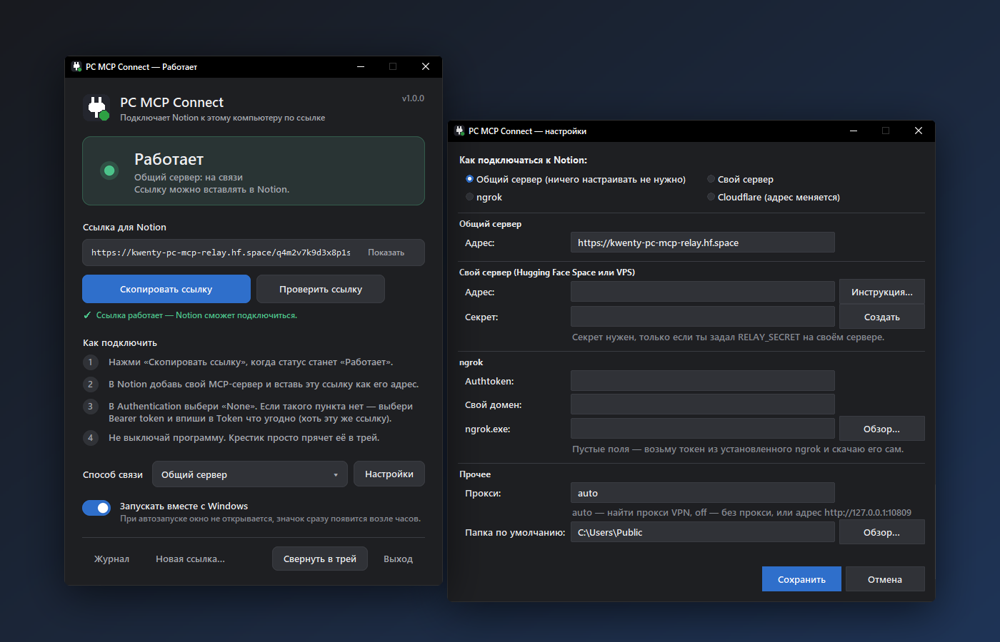
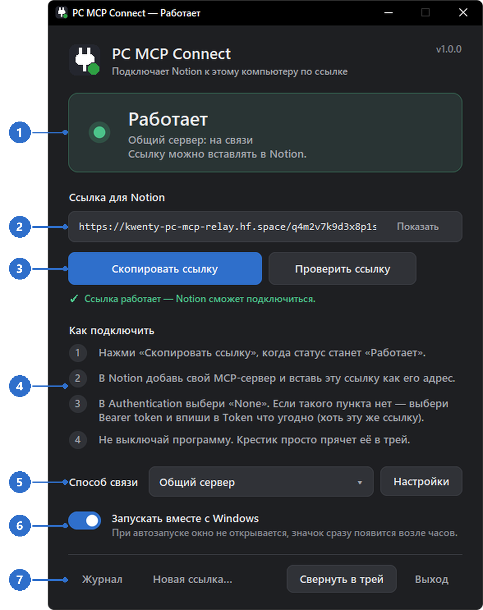
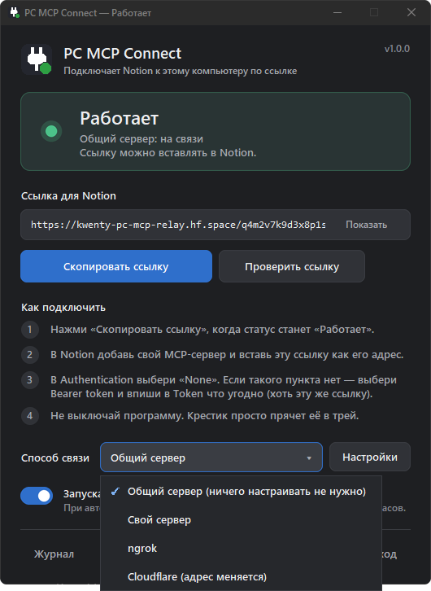
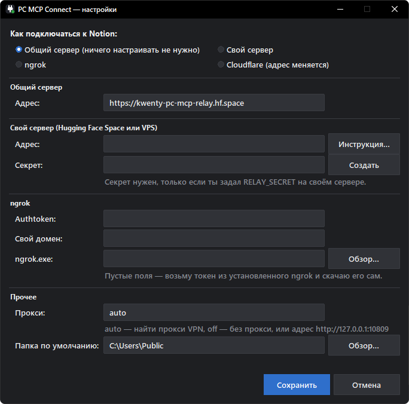

<h1 align="center">🔌 PC MCP Connect</h1>

<p align="center">
  <b>Подключи Notion AI к своему компьютеру по одной ссылке.</b><br>
  Без белого IP, проброса портов и настроек. Работает из России без VPN.
</p>

<p align="center">
  <a href="https://github.com/Kw3nty/pc-mcp-connect/releases/latest"></a>
  
  
  <a href="https://github.com/Kw3nty/pc-mcp-connect/releases"></a>
</p>

<p align="center">
  <a href="https://github.com/Kw3nty/pc-mcp-connect/releases/latest/download/PcMcpConnect.exe"><b>⬇️ Скачать PcMcpConnect.exe</b></a>
  &nbsp;•&nbsp;
  <a href="#-быстрый-старт">Быстрый старт</a>
  &nbsp;•&nbsp;
  <a href="#-способы-связи">Способы связи</a>
  &nbsp;•&nbsp;
  <a href="#-частые-вопросы">FAQ</a>
</p>

<p align="center">
  
</p>

---

## ✨ Что это

**PC MCP Connect** — маленькая программа для Windows. Она запускает на твоём компьютере MCP-сервер и даёт **одну постоянную ссылку**. Вставляешь её в Notion — и агент Notion AI может работать с файлами, запускать команды и программы прямо на твоём ПК.

- 🔗 **Одна ссылка навсегда** — не меняется при перезапусках компьютера и программы.
- 🇷🇺 **Без VPN** — в режиме «Общий сервер» связь идёт через Hugging Face, который открывается из России напрямую.
- 🧰 **Ничего настраивать не нужно** — ни белого IP, ни роутера, ни Python. Один exe-файл.
- ♻️ **Сама переподключается** при обрывах и может запускаться вместе с Windows.
- 👥 **Можно раздавать друзьям** — у каждого компьютера своя ссылка и свой канал.

### 🤖 Что сможет агент

| Инструмент | Что делает |
|---|---|
| `system_info` | узнать ОС, пользователя, папку по умолчанию |
| `run_command` | выполнить команду (cmd, PowerShell, bash) и получить вывод |
| `start_process` · `read_process` · `stop_process` · `list_processes` | долгие процессы: сборки, серверы, скрипты |
| `read_file` · `write_file` · `edit_file` | читать, создавать и править текстовые файлы |
| `read_file_base64` · `write_file_base64` | картинки, архивы и другие двоичные файлы |
| `list_dir` · `delete_path` | просмотр папок и удаление |

---

## 🚀 Быстрый старт

**1. Скачай и запусти** [`PcMcpConnect.exe`](https://github.com/Kw3nty/pc-mcp-connect/releases/latest/download/PcMcpConnect.exe). Устанавливать ничего не нужно — сразу откроется окно программы.

> [!TIP]
> Если Windows покажет синее окно «Система Windows защитила ваш компьютер» — нажми **Подробнее → Выполнить в любом случае**. Так бывает со всеми неподписанными программами.

**2. Дождись статуса «Работает»** (зелёная точка, обычно пара секунд) и нажми **«Скопировать ссылку»**.

**3. Добавь сервер в Notion:** настройки агента → **Подключения (Connections) → Добавить → Custom MCP server** и заполни:

| Поле в Notion | Что указать |
|---|---|
| **URL** | скопированную ссылку `https://…/mcp` |
| **Name** | любое, например `PC MCP` |
| **Authentication** | **None** |

> [!NOTE]
> Если в списке **Authentication** нет пункта **None** — выбери **Bearer token** и впиши в поле **Token** что угодно (хоть ту же ссылку). Программа этот токен не проверяет: доступ защищает секретный токен внутри самой ссылки.

**4. Не выключай программу.** Крестик просто прячет окно в трей — программа продолжает работать. Готово 🎉

---

## 🖥️ Окно программы

<p align="center">
  
</p>

1. **Статус связи** — главное в окне. Здесь же написано, через какой сервер идёт связь и что пошло не так.
2. **Ссылка для Notion.** Секретный токен в ней скрыт звёздочками `***`, кнопка **«Показать»** раскрывает её целиком.
3. **«Скопировать ссылку»** копирует полную ссылку. **«Проверить ссылку»** открывает её извне так же, как это сделает Notion, и пишет результат прямо под кнопками.
4. **Как подключить** — короткая шпаргалка из «Быстрого старта». На маленьких экранах прячется, чтобы окно помещалось.
5. **Способ связи** и **Настройки** — см. [Способы связи](#-способы-связи) и [Настройки](#️-настройки).
6. **Запускать вместе с Windows.** При автозапуске окно не открывается — программа тихо появляется значком возле часов.
7. **Нижняя панель:**
   - **Журнал** — открыть лог, если что-то не работает;
   - **Новая ссылка…** — сменить секретный токен (старая ссылка сразу перестанет работать);
   - **Свернуть в трей** — убрать окно, связь остаётся;
   - **Выход** — полностью выключить (перед этим спросит подтверждение).

### 🚦 Статусы

| | Статус | Что значит |
|:-:|---|---|
| 🟢 | **Работает** | всё готово, ссылку можно вставлять в Notion |
| 🟡 | **Подключаюсь…** | запуск или переподключение после обрыва — просто подожди |
| 🔴 | **Есть проблема** | причина написана под статусом, подробности — в «Журнале» |

Тем же цветом горит точка на значке в трее.

### 📌 Значок в трее

Нажми на значок-вилку возле часов (если его не видно — стрелка **˄** в трее), чтобы открыть окно. В меню по правому клику — всё самое нужное без окна: текущий статус, *Скопировать ссылку для Notion*, *Проверить ссылку*, *Способ связи*, *Настройки…*, *Запускать вместе с Windows*, *Открыть журнал* и *Выход*.

Повторный запуск `PcMcpConnect.exe` не создаёт вторую копию, а просто показывает уже запущенную.

---

## 🔌 Способы связи



По умолчанию включён **Общий сервер** — с ним ничего настраивать не нужно. Остальные режимы пригодятся, если хочешь полной приватности или общий сервер вдруг недоступен.

Режим меняется в выпадающем списке **«Способ связи»** или в меню трея. После смены режима ссылка меняется и сама копируется — обнови её в Notion.

Для ngrok и Cloudflare программа сама скачивает нужную утилиту и ищет локальный прокси VPN (v2rayN, Clash, Hiddify, Nekoray и т.п.) — за это отвечает поле «Прокси: auto».

<br clear="right">

| Режим | Ссылка меняется? | VPN из РФ | Что нужно |
|---|---|---|---|
| 🌐 **Общий сервер** (по умолчанию) | нет | не нужен | ничего — адрес вшит в программу |
| 🏠 **Свой сервер** | нет | не нужен | свой бесплатный Space на Hugging Face — [5 минут](#-свой-сервер-за-5-минут) |
| 🚇 **ngrok** | нет, если есть бесплатный домен ngrok | нужен (ngrok блокирует РФ) | authtoken ngrok |
| ☁️ **Cloudflare** | да, при каждом запуске | нужен (РФ блокирует Cloudflare) | ничего |

---

## ⚙️ Настройки

<p align="center">
  
</p>

| Раздел | Для чего |
|---|---|
| **Как подключаться к Notion** | тот же выбор режима, что и в главном окне |
| **Общий сервер** | адрес общего сервера-посредника (уже заполнен) |
| **Свой сервер** | адрес твоего Space и, если задан `RELAY_SECRET`, его секрет (кнопка **«Создать»** сгенерирует надёжный) |
| **ngrok** | authtoken, свой домен и путь к `ngrok.exe`. Пустые поля — токен берётся из установленного ngrok, сам ngrok скачивается автоматически |
| **Прокси** | `auto` — найти прокси VPN, `off` — без прокси, или адрес вроде `http://127.0.0.1:10809` |
| **Папка по умолчанию** | где агент оказывается, если не указал путь (относительные пути и рабочая папка команд) |

---

## 🔒 Безопасность

> [!WARNING]
> **Ссылка даёт полный доступ к компьютеру** — файлы, команды, процессы. Обращайся с ней как с паролем: не публикуй, не кидай в общие чаты. Если она утекла — нажми **«Новая ссылка…»**, старая сразу перестанет работать.

- Ссылка выглядит так: `https://<сервер>/<канал>/<токен>/mcp`.
- **Канал** — хеш секретного ключа, который знает только твой компьютер: занять чужой канал нельзя.
- **Токен** проверяет сам MCP-сервер на твоём компьютере. В окне и журналах он скрыт.
- Сервер-посредник ничего не хранит — только пересылает запросы. Но технически его владелец видит проходящий трафик. Для полной приватности сделай [свой сервер](#-свой-сервер-за-5-минут).

---

## 🏠 Свой сервер за 5 минут

1. Зарегистрируйся на [huggingface.co](https://huggingface.co).
2. **New → Space** → SDK **Gradio** → шаблон *Blank* → Hardware *CPU basic (FREE)* → видимость **Public** (иначе Notion не достучится).
3. Загрузи в Space файлы `app.py`, `relay.py`, `requirements.txt` из папки [`relay/`](relay/). Файл `README.md` самого Space не трогай.
4. Дождись статуса *Running* (1–3 минуты). Проверка: `https://<адрес>/_relay/ping` отвечает `ok`.
5. В программе: **Способ связи → Свой сервер**, вставь адрес `https://<логин>-<имя-space>.hf.space` → **Сохранить**.

Хочешь, чтобы к серверу подключались только твои компьютеры? Добавь в Space секрет `RELAY_SECRET` и укажи его же в настройках программы. Подробности, VPS и Docker — в [`relay/README.md`](relay/README.md).

---

## ❓ Частые вопросы

<details>
<summary><b>Windows или антивирус ругается на exe</b></summary>

<br>

exe не подписан сертификатом и собран PyInstaller — SmartScreen и некоторые антивирусы такие файлы не любят. В SmartScreen нажми **Подробнее → Выполнить в любом случае**, в антивирусе добавь файл в исключения. Исходники открыты — можно [собрать exe самому](#️-для-разработчика).

</details>

<details>
<summary><b>Notion не подключается к серверу</b></summary>

<br>

1. Убедись, что статус — 🟢 **Работает**.
2. Нажми **«Проверить ссылку»** — программа откроет её так же, как Notion, и напишет, в чём дело.
3. Проверь, что в Notion вставлена **актуальная** ссылка (после «Новая ссылка…» или смены режима она меняется), а Authentication — **None** или Bearer token с любым текстом.

</details>

<details>
<summary><b>«Эта ссылка уже используется на другом компьютере»</b></summary>

<br>

Такие же настройки запущены ещё где-то — например, папку `%APPDATA%\PcMcpConnect` скопировали на другой ПК. Закрой программу там или удали на одном из компьютеров `config.json` — программа создаст новую ссылку.

</details>

<details>
<summary><b>Работает ли когда компьютер выключен или спит?</b></summary>

<br>

Нет — агент работает с компьютером напрямую, поэтому ПК должен быть включён, а программа запущена. После пробуждения или перезагрузки программа сама переподключится, а ссылка останется той же. Чтобы не запускать её руками, включи **«Запускать вместе с Windows»**.

</details>

<details>
<summary><b>Общий сервер перестал отвечать</b></summary>

<br>

Бесплатный Space на Hugging Face иногда засыпает или перезапускается. Программа сама переподключится, как только сервер оживёт. Не хочешь зависеть от общего — [сделай свой](#-свой-сервер-за-5-минут).

</details>

<details>
<summary><b>Где лежат настройки и журнал?</b></summary>

<br>

- Настройки: `%APPDATA%\PcMcpConnect\config.json`
- Журнал: `%LOCALAPPDATA%\PcMcpConnect\app.log` (кнопка **«Журнал»** в окне)

</details>

---

## 🛠️ Для разработчика

### Как это устроено

```
Notion ──HTTPS──▶ relay (Hugging Face) ◀──WebSocket── PcMcpConnect.exe ──▶ MCP-сервер 127.0.0.1
```

- Компьютер сам подключается к relay исходящим WebSocket, поэтому не нужны белый IP, проброс портов, ngrok и Cloudflare. `*.hf.space` открывается из России напрямую, а Notion ходит на него из США без проблем.
- Ссылка не меняется при перезапусках компьютера и сервера.
- Если прямое подключение к relay не проходит, программа пробует найденные прокси VPN.

### Своя сборка

1. Разверни **общий сервер** на Hugging Face по [`relay/README.md`](relay/README.md) (без `RELAY_SECRET`).
2. Впиши его адрес в `defaults.json`:
   ```json
   { "shared_relay_url": "https://<логин>-pc-mcp-relay.hf.space" }
   ```
3. Запусти `build.bat` (нужен Python 3.11+). Готовый файл — `dist\PcMcpConnect.exe`, его и раздавай.

> [!IMPORTANT]
> Перед пересборкой закрой запущенную программу (**Выход**): Windows не даст перезаписать работающий exe, и в `dist` останется старая версия.

`defaults.json` можно также положить рядом с уже собранным exe — он переопределит вшитый адрес.

### Ключи запуска

| Команда | Что делает |
|---|---|
| `PcMcpConnect.exe` | окно + значок в трее |
| `PcMcpConnect.exe --minimized` | сразу в трей, без окна (так запускается автозапуск) |
| `python app\pcmcp_connect.py --headless [--seconds N]` | без окна и трея, для отладки |

### Файлы

```
app/
  pcmcp_connect.py   приложение: подключения, режимы, настройки
  ui_main.py         главное окно и значок в трее
  pc_mcp_server.py   MCP-сервер: файлы, команды, процессы
  make_icon.py       иконка приложения
relay/               сервер-посредник для Hugging Face / VPS
docs/screenshots/    картинки для README
build.bat            сборка exe через PyInstaller
defaults.json        адрес общего сервера
```

<p align="center"><sub>Сделано для тех, кому нужен Notion AI, который умеет что-то делать на своём компьютере 🖤</sub></p>
